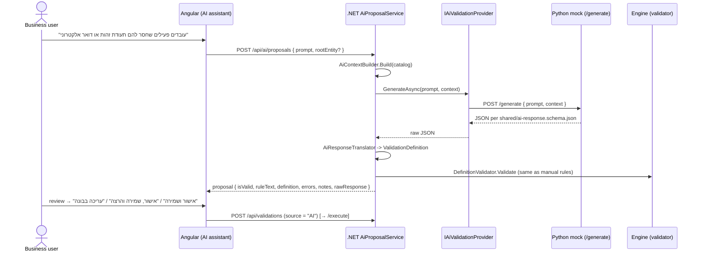

# AI-based validation definition (Phase B)

## 1. Flow



Nothing is saved or executed until the user approves. An approved proposal is an ordinary validation: same storage, same execution engine, same results screen.

## 2. Context supplied to the model

`GET /api/ai/context` shows exactly what is sent. It is built **only from the metadata catalog**:
- `instructions`: the task rules for a future model (use only the given paths, no SQL, how to compare fields, nesting, when to return `unsupported`).
- `entities[]`: key, Hebrew names, description, relationships, and every reachable field (own fields plus fields one relationship away), each with:
  - the path and Hebrew label;
  - the data type, description and **synonyms**;
  - the boolean labels;
  - the operators allowed for that field.
- `operators[]`: the operator catalog.
- `responseSchema`: the JSON schema the answer must follow.

Physical table and column names are never included.

## 3. Structured response format

The format is defined in [`shared/ai-response.schema.json`](../shared/ai-response.schema.json) (JSON Schema 2020-12). The single file is embedded in the .NET Core assembly and is also read by the Python tests. The format is deliberately **simpler than the engine's definition**: no ids, no operand kinds, `compareToField` instead of an operand object. That keeps it easy for a model to produce, and makes the translation step explicit.

Example (actual mock output):
```json
{
  "status": "ok",
  "name": "עובדים פעילים שחסר להם תעודת זהות או דואר אלקטרוני",
  "description": "עובדים פעילים שחסר להם תעודת זהות או דואר אלקטרוני",
  "rootEntity": "Employee",
  "logic": "And",
  "conditions": [
    { "field": "IsActive", "operator": "Equals", "value": true },
    { "logic": "Or", "conditions": [
        { "field": "NationalId", "operator": "IsEmpty" },
        { "field": "Email", "operator": "IsEmpty" } ] }
  ],
  "confidence": 0.95,
  "notes": ["תשובה זו נוצרה על ידי מנגנון Mock מבוסס כללים (ללא מודל AI אמיתי)."]
}
```

`AiResponseTranslator` converts this into the engine definition:
- condition ids are generated (`c1`, `g1` …);
- `compareToField` becomes a `field` operand, and `values` becomes a `list` operand;
- unknown properties, operators or logic values are rejected.

The result then goes through the regular `DefinitionValidator`. For this example the proposal shows:
> סטטוס עובד: פעיל וגם (חסר ערך בשדה "תעודת זהות" או חסר ערך בשדה "דואר אלקטרוני")

## 4. The Python mock

`ai-mock/` uses only the Python standard library and runs on Python 3.7+:

| File | Role |
|---|---|
| `server.py` | `ThreadingHTTPServer`: `POST /generate`, `GET /health`, JSON in and out, errors returned as JSON |
| `ai_provider.py` | `AiProvider` abstract base class and the `create_provider(name)` factory (`--provider` / `AI_PROVIDER`) |
| `mock_provider.py` | `MockAiProvider`: a rule-based Hebrew parser |
| `hebrew_text.py` | Tokenizing, plus matching that ignores Hebrew prefixes (ו/ה/ש/מ/ל/ב/כ) and common suffixes |

The mock is **driven entirely by the context it receives**. It has no field names of its own; one test renames a label in the context and checks that the mock follows the change. It recognizes:
- field mentions, by label or synonym (longest match, preferring the current entity context);
- comparison words: מתחת / קטן / פחות / מוקדם / לפני → `LessThan`; מעל / גדול / גבוה / מאוחר / אחרי → `GreaterThan`; שווה; שונה;
- numbers (`15,000`) and dates (`01/01/2010` → `2010-01-01`);
- a field followed by a comparison word and another field, which becomes a field-to-field comparison;
- empty markers (חסר / ריק / ללא / בלי / אין), which turn the following fields into `IsEmpty`;
- status words matched against boolean labels (פעילים / לא פעילה), attached to the most recently mentioned entity or relationship (במחלקה → `Department.IsActive`);
- `או` (or), which groups adjacent conditions into an OR group that is ANDed with the rest: "פעילים שחסר להם X או Y" → `IsActive AND (X OR Y)`.

### Demo prompts
| Prompt | Proposal |
|---|---|
| עובדים מתחת לגיל 18 עם שכר חודשי מעל 15000 | `Age < 18 AND Salary > 15000` |
| עובדים שתאריך סיום העסקה מוקדם מתאריך תחילת העסקה | `EndDate < StartDate` |
| עובדים פעילים במחלקות לא פעילות | `IsActive = true AND Department.IsActive = false` |
| עובדים שחסר להם תעודת זהות או דואר אלקטרוני או שיוך למחלקה או תאריך לידה | OR of 4 `IsEmpty` |
| עובדים עם שכר חודשי גבוה משכר מקסימלי לתפקיד | `Salary > Position.MaxSalary` |
| עובדים פעילים שהמנהל הישיר שלהם לא פעיל | `IsActive = true AND Manager.IsActive = false` |
| מחלקות שמנהלן אינו פעיל | root `Department`: `Manager.IsActive = false` |
| מה מזג האוויר מחר | `unsupported`, shown as an invalid proposal with an explanation |

The first five produce exactly the same records as V1–V5 (verified by `AiEndToEndTests`).

To demo in the UI, open **יצירה בעזרת AI** (create with AI) and click an example chip, or open `http://localhost:4200/ai?q=<prompt>`. To demo the API directly:
```powershell
Invoke-RestMethod -Method Post -Uri http://localhost:5080/api/ai/proposals `
  -ContentType 'application/json; charset=utf-8' `
  -Body ([Text.Encoding]::UTF8.GetBytes('{"prompt":"עובדים מתחת לגיל 18 עם שכר חודשי מעל 15000"}'))
```

## 5. Replacing the mock with a real model

There are two options. Neither touches the validation engine, the executor or the UI.

1. **Keep the HTTP contract.** Add a provider in Python, e.g. `class LlmProvider(AiProvider)`. It sends `context["instructions"]`, `context` (including `responseSchema`) and the prompt to an LLM with JSON or structured output enabled, then returns the parsed JSON. Register it in `create_provider()` and run `python server.py --provider llm`.
2. **Call the model from .NET.** Implement `IAiValidationProvider` (for example `AnthropicValidationProvider`) and replace the single registration in `Infrastructure/DependencyInjection.cs`.

Either way, the response goes through the same translator and the same catalog validation. A model that invents a field, an operator or SQL produces a proposal marked invalid, with Hebrew errors. It can never produce an executable query.

## 6. Separation from the engine

- `Core/Ai` depends on the engine (it produces definitions); the engine does **not** depend on `Core/Ai`.
- The AI component never builds SQL and never executes anything.
- When the AI service is unavailable, `POST /api/ai/proposals` returns HTTP 503 with a Hebrew message. Everything else keeps working.
