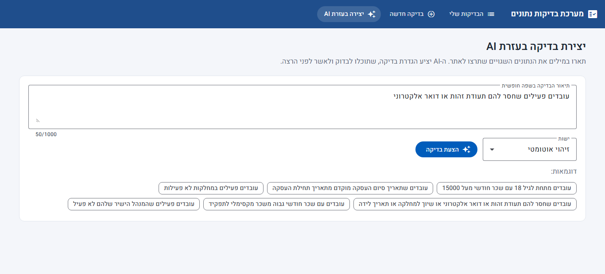
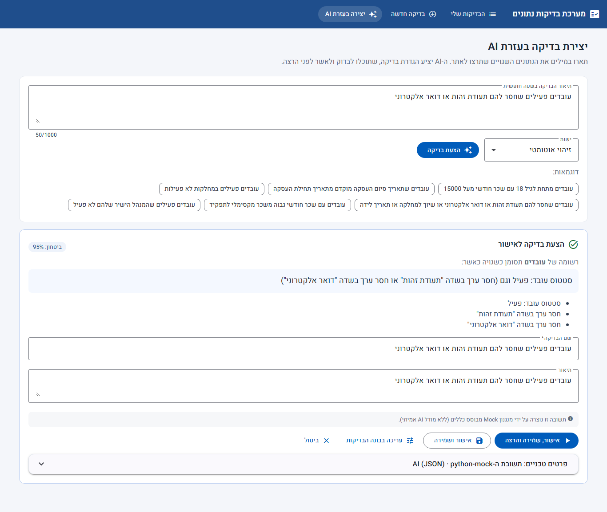
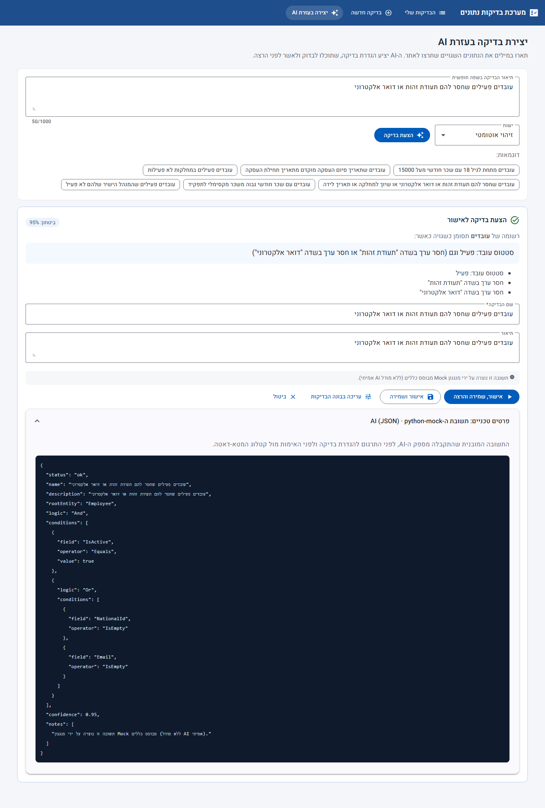
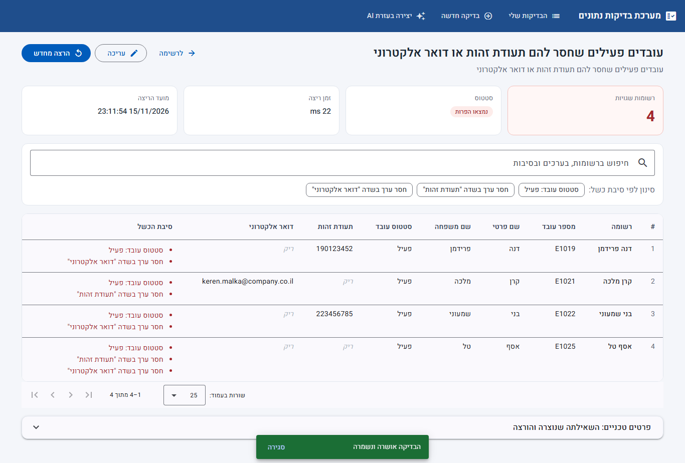
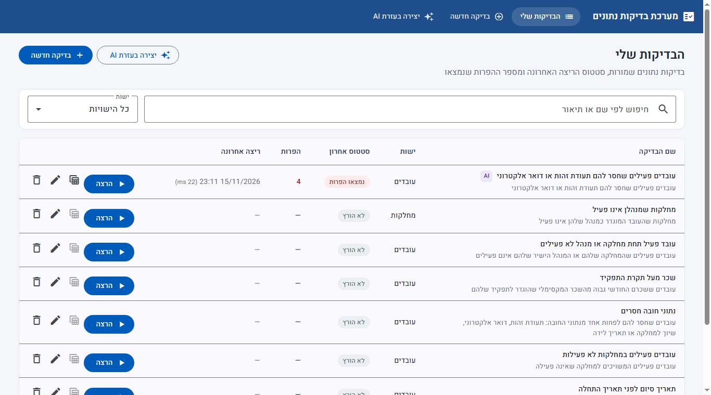
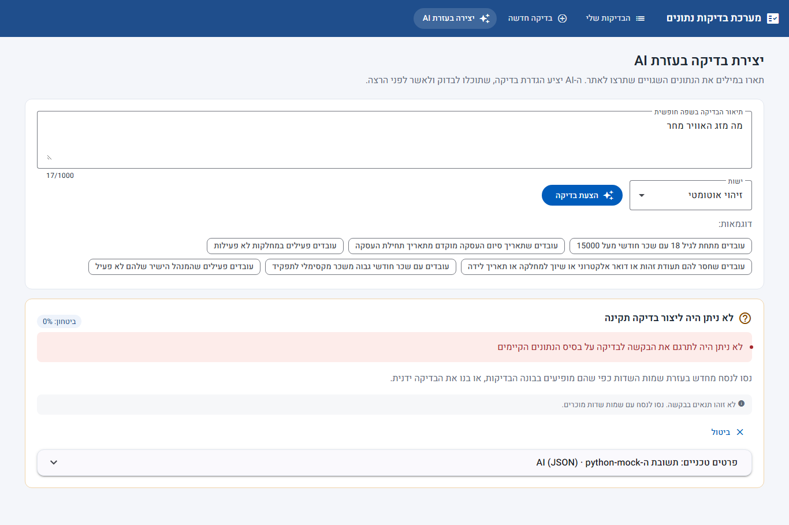
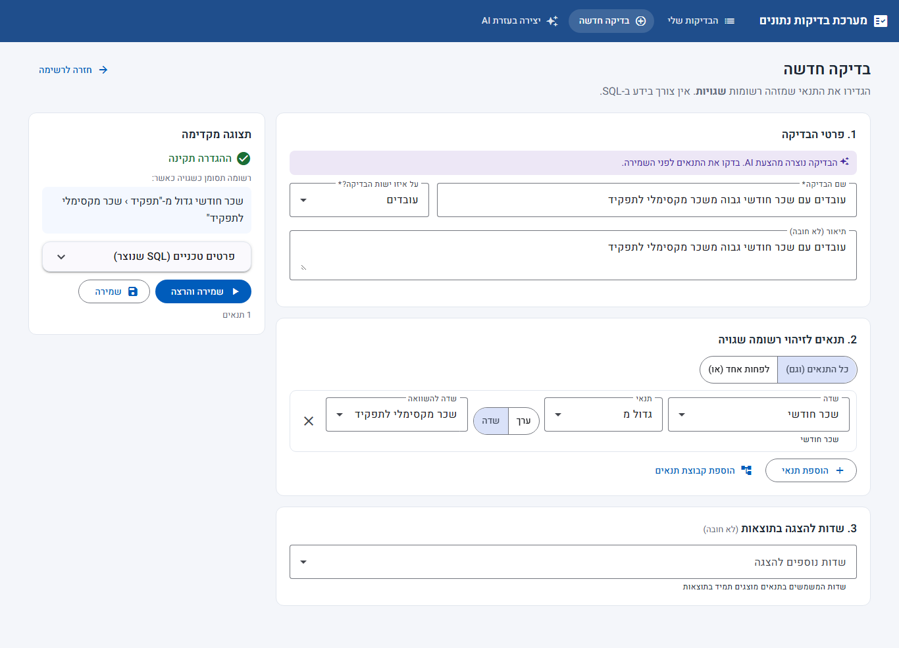

# Stage B demonstration: natural language → validation (with the Python mock)

All screenshots below were taken from the **running application**: Angular UI → .NET API → Python mock → SQL Server. Each step was performed by clicking in the UI; nothing was edited by hand.

> **What is simulated and what is real**
> - **Simulated:** only the "AI model". `ai-mock/mock_provider.py` is a **rule-based Hebrew matcher**. It finds field labels, synonyms, comparison words, numbers and dates from the metadata context it receives. It is not a language model, and its confidence score is a heuristic.
> - **Real (implemented and tested):** everything around the model:
>   - building the context from the metadata catalog;
>   - the HTTP provider interface (`IAiValidationProvider`);
>   - the structured response format (`shared/ai-response.schema.json`);
>   - translating the response into the same definition used in Stage A;
>   - validating it against the catalog;
>   - the approval UI;
>   - saving and executing it with the generic engine.
>
> Replacing the mock with a real model needs no change to any of those parts ([AI.md §5](AI.md#5-replacing-the-mock-with-a-real-model)).

Prerequisites: the database is set up and the three services are running (`scripts\start-dev.cmd`). See the [README](../README.md#3-installation-and-running).

---

## Step 1: Describe the control in free text

Open **יצירה בעזרת AI** (create with AI) and type a request in Hebrew, or click one of the example chips. Here the request is:

> עובדים פעילים שחסר להם תעודת זהות או דואר אלקטרוני
> *(active employees missing a national ID or an e-mail address)*

"ישות" (entity) is left on "זיהוי אוטומטי" (automatic), so the mock picks the entity from the text.

## Step 2: Proposal for review (nothing saved yet)

Clicking **הצעת בדיקה** (propose a validation) calls `POST /api/ai/proposals`. The backend then:
1. builds the AI context from the catalog. Only Hebrew labels, synonyms, allowed operators and the response schema are included; no table or column names;
2. sends `{ prompt, context }` to the Python mock (`POST http://localhost:5005/generate`);
3. translates the mock's JSON into the engine's validation definition (*real*);
4. validates it with the **same validator** that checks manually built rules (*real*);
5. describes it in Hebrew with the same reason builder used for results (*real*).

The proposal shows the readable rule, which contains a nested group the mock produced from the word "או" (or):
**סטטוס עובד: פעיל וגם (חסר ערך בשדה "תעודת זהות" או חסר ערך בשדה "דואר אלקטרוני")**
*(employee status: active AND (national ID missing OR e-mail missing))*

It also shows the separate conditions, an editable name and description, the mock's note that it is a rule-based mock, and a confidence of 95%. That confidence is a mock heuristic.

## Step 3: The structured AI response

The technical panel shows the raw JSON returned by the mock, before translation and validation. The same format is required from any future real provider (`shared/ai-response.schema.json`).

## Step 4: User approval → executed by the generic engine

Clicking **אישור, שמירה והרצה** (approve, save and run):
- saves the definition as a regular validation (`source = "AI"`);
- runs it with the generic engine: a generated parameterized `SELECT`, executed as the read-only `validation_reader`.

The result is the same as for a manually built control: **4 violating records** (E1019, E1021, E1022, E1025). Each record lists every reason it failed; E1025 is missing both values, so it shows both reasons. Filtering by reason and the run details work exactly as for any other control.

## Step 5: The approved control in the list

The new control appears in **הבדיקות שלי** (my validations) with an **AI** tag, its latest status and its violation count. From here it is edited and rerun like any other control.

## Step 6: A request the mock cannot map

For a request unrelated to the catalog ("מה מזג האוויר מחר", *what's the weather tomorrow*), the mock returns `status: "unsupported"`. The UI shows an invalid proposal with an explanation, and **the approve buttons are not shown**: an invalid proposal cannot be saved or executed.

## Step 7: Alternative to approval: refine in the builder

**עריכה בבונה הבדיקות** (edit in the validation builder) opens the proposal in the regular Stage A builder, marked as created from an AI proposal. Here the proposal is a field-to-field comparison across a relationship: *monthly salary > position's maximum salary*. The user can adjust conditions, and the live preview validates them against the backend, before saving.

---

## How to reproduce

1. `.\db\setup-database.ps1`, then double-click `scripts\start-dev.cmd`, then open http://localhost:4200/ai.
2. Click an example chip, or type a request. Shortcut: `http://localhost:4200/ai?q=<request>` pre-fills and submits it; approval is still required.
3. Requests the mock understands (each is verified by `AiEndToEndTests` / `ai-mock/tests`):

| Request | Proposed rule |
|---|---|
| עובדים מתחת לגיל 18 עם שכר חודשי מעל 15000 | `Age < 18 AND Salary > 15000` |
| עובדים שתאריך סיום העסקה מוקדם מתאריך תחילת העסקה | `EndDate < StartDate` |
| עובדים פעילים במחלקות לא פעילות | `IsActive = true AND Department.IsActive = false` |
| עובדים שחסר להם תעודת זהות או דואר אלקטרוני או שיוך למחלקה או תאריך לידה | OR of 4 "empty" checks |
| עובדים עם שכר חודשי גבוה משכר מקסימלי לתפקיד | `Salary > Position.MaxSalary` |
| עובדים פעילים שחסר להם תעודת זהות או דואר אלקטרוני | `IsActive = true AND (NationalId empty OR Email empty)` |

Phrasing outside the mock's simple rules (see [AI.md §4](AI.md#4-the-python-mock)) returns "unsupported" or a partial rule. This is a limitation of the **mock**, not of the pipeline.

Approving a proposal saves a new validation. Re-run `db\setup-database.ps1` to return to the clean demo state.
